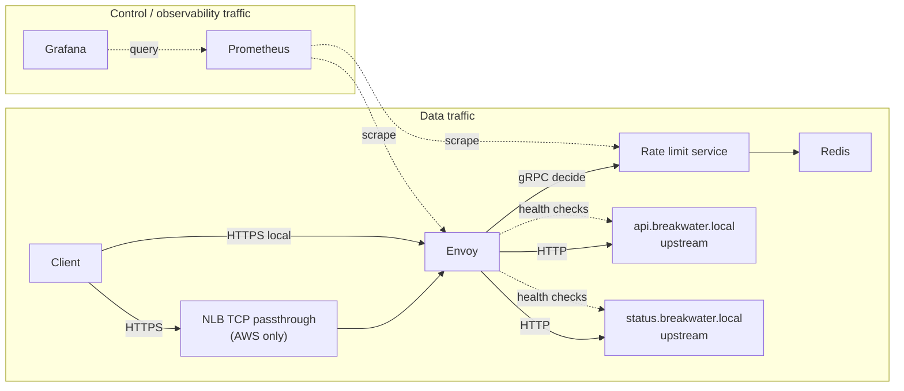

# Breakwater

Edge traffic is easy to describe and hard to get right: terminate TLS,
route by host and path, enforce distributed limits, isolate unhealthy
upstreams, and still explain latency and failure under load.

Breakwater is a small, inspectable **data-plane** edge tier in front of
sample HTTP APIs. It is built so a network or platform engineer can
clone it, run it, stress it, break it, and understand the tradeoffs.

It is **not** an API gateway product, a service mesh, or a control-plane
change-management system. Those are different problems.

## Status

**Milestone 3 — plaintext Envoy reverse proxy.** Client HTTP traffic can
reach `upstream-api` through Envoy on port 8080. TLS, host-based routing,
Redis, rate limiting, Prometheus, Grafana, Terraform apply, and benchmarks
are **not** implemented yet.

**Cost:** The project is designed to be completed at **zero cloud spend**.
Real AWS apply is optional validation only—never required for Definition
of Done. See [`BUILD_PLAN.md`](BUILD_PLAN.md) §0.1 and [`docs/cost.md`](docs/cost.md).

See [`BUILD_PLAN.md`](BUILD_PLAN.md), [`BREAKWATER_BUILD_SPEC.md`](BREAKWATER_BUILD_SPEC.md),
and [`services/upstream/README.md`](services/upstream/README.md).

## Architecture (preview)



Full write-up: [`docs/architecture.md`](docs/architecture.md).

## What this project will demonstrate

| Capability | Notes |
| --- | --- |
| TLS at Envoy | NLB stays TCP passthrough on AWS so Envoy remains the termination point |
| Host + path routing | `api.breakwater.local` and `status.breakwater.local` |
| Distributed rate limits | Redis-backed token bucket via Envoy external rate limit |
| Failure policy as config | **Standard** routes fail open if Redis/RL is down; **sensitive** routes fail closed |
| Measurement | Direct upstream → Envoy without RL → Envoy with RL; edge overhead calculated |
| Observability | Prometheus + Grafana as code |
| AWS-credible IaC | Terraform designs NLB TCP → EC2+Compose; **static validation only** for DoD (apply optional, not required) |

## Data traffic vs control traffic

- **Data traffic:** client requests flowing through Envoy to upstreams
  (the path under study for latency, 429s, and failure isolation).
- **Control traffic:** health checks, metrics scrapes, status surface,
  configuration, and operator failure injection. Benchmarks and failure
  write-ups must not conflate the two.

## Quick start (current)

```bash
make bootstrap
cp -n .env.example .env
make validate-envoy
make up
make smoke              # functional checks via Envoy (not a benchmark)
make test-upstream
make test-integration
```

Data path: `http://127.0.0.1:8080/api/v1/items` → Envoy → `upstream-api`.

Test controls (local only; disable with `ENABLE_TEST_CONTROLS=false`):

```bash
curl -s -X POST http://127.0.0.1:9001/__test__/errors \
  -H 'content-type: application/json' -d '{"mode":"http_500","count":1}'
curl -s http://127.0.0.1:8080/api/v1/items
curl -s -X POST http://127.0.0.1:9001/__test__/reset
```

## Documentation

| Doc | Purpose |
| --- | --- |
| [BUILD_PLAN.md](BUILD_PLAN.md) | Milestones, decisions, cost path |
| [docs/architecture.md](docs/architecture.md) | Request paths and component roles |
| [docs/adr/](docs/adr/) | Architecture decision records |
| [BREAKWATER_BUILD_SPEC.md](BREAKWATER_BUILD_SPEC.md) | Engineering contract |

## License

Apache License 2.0. See [LICENSE](LICENSE).
