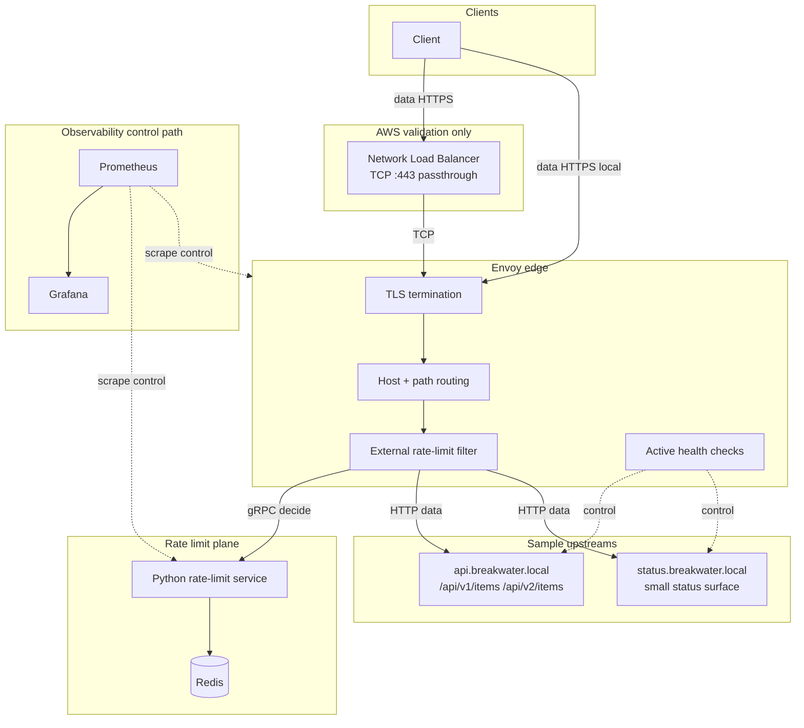

# Breakwater Architecture

This document describes the intended architecture. Runtime components
land in later milestones; nothing here claims a live integration until
that milestone has been exercised.

## Problem

At the edge you need predictable behavior when:

- clients are abusive or bursty
- an upstream is slow, returning 5xx, or gone
- the rate-limit dependency is degraded
- you must explain whether latency came from TLS/proxying, rate
  limiting, or the application

Breakwater is a deliberately small edge tier that makes those behaviors
inspectable.

## Scope

**In scope:** TLS termination, host/path routing, distributed rate
limiting, upstream health isolation, telemetry, load testing, minimal
AWS validation.

**Out of scope:** application authentication/billing, general service
mesh, Kubernetes/ECS/WAF/extra proxies (unless a measured limitation
forces a revisit), merging with control-plane change-management systems.

## Data traffic vs control traffic

Keep this distinction in configuration, dashboards, benchmarks, and
incident narratives.

| | Data traffic | Control traffic |
| --- | --- | --- |
| **What** | Client requests entering through Envoy toward application upstreams | Health checks, Prometheus scrapes, Grafana queries, status host, operator inject/admin tooling |
| **Why it matters** | Defines user-visible latency, 429s, routing, TLS | Defines whether we can *see* and *operate* the data plane |
| **Benchmark rule** | k6 scenarios measure data traffic | Do not count scrapes/health as offered load |
| **Failure rule** | Rate-limit and upstream failures affect data responses | Control-path outages affect visibility/ops; document separately |

Breakwater demonstrates the **data plane** (“how does traffic enter, get
routed, protected, observed, and delivered?”). It is intentionally not a
control-plane workflow product for changing network infrastructure.

## Logical diagram



Solid arrows are **data traffic** (plus the rate-limit decision on the
request path). Dotted arrows are **control / observability traffic**.

## Components

### Envoy

Owns TLS termination, host and path routing, timeouts, conservative
retries on safe GETs, active health checking, rate-limit filter
integration, access logs, and Prometheus metrics.

### Rate-limit service + Redis

Envoy-compatible external rate limiting with token buckets in Redis.
Client identity for the demo is derived via an abstraction that today
reads `x-client-id` (spoofable; not production auth).

**Failure policy (configurable by route class):**

| Route class | When Redis or RL service is unavailable |
| --- | --- |
| **Standard** (default API data path) | **Fail open** — allow traffic; emit metrics/logs |
| **Sensitive** | **Fail closed** — deny/error per Envoy+policy wiring; emit metrics/logs |

Both behaviors must be integration-tested and observable.

### Sample upstreams

FastAPI services exist to make edge behavior measurable:

- `api.breakwater.local` — versioned items API with injectable latency/5xx/crash
- `status.breakwater.local` — deliberately small status surface (not an admin product)

### Prometheus + Grafana

Scrape and dashboard the edge and dependencies. Dashboards are
provisioned as code. On AWS validation, keep this path private.

### NLB (Terraform design; apply optional)

L4 TCP passthrough to Envoy in the AWS-shaped IaC. **Does not terminate
TLS.** Terminating TLS on the NLB would invalidate the Envoy TLS
architecture. Local Compose has no NLB; Envoy still terminates TLS on the
**required zero-cost** path.

### Compute (Terraform design; apply optional)

Modules describe a single EC2 host running Docker Compose (Envoy, Redis,
rate-limit, upstreams). Redis on-instance — not ElastiCache. **Required
proof is local Compose + static Terraform validation.** Real AWS apply is
optional and outside Definition of Done (see `docs/cost.md`).

## Routing (preview)

Exact tables land with Milestone 5. Intended shape:

| Host | Paths (planned) | Notes |
| --- | --- | --- |
| `api.breakwater.local` | `/api/v1/items`, `/api/v2/items`, `/health` | Primary data API |
| `status.breakwater.local` | small status routes + `/health` | Second host for host-based routing; keep minimal |

Rate-limit **failure class** (standard fail-open vs sensitive fail-closed)
is assigned per route in Envoy/RL config — not equated wholesale with a
hostname. Exact route→class mapping lands with Milestone 5/8.
| unknown host / path | explicit documented behavior | No silent fall-through |

## TLS placement

```text
Client --TLS--> Envoy --HTTP on private network--> upstreams
                 ^
                 |
         TLS terminates here
```

Local certificates are development-only. Production-style rotation and
internal mTLS are documented as extensions, not required for v1 proof.

## Benchmark philosophy

Measure in order:

1. Direct to upstream (no Envoy)
2. Through Envoy with rate limiting disabled
3. Through Envoy with rate limiting enabled

**Edge-added latency** is calculated from (1) vs (2). Rate-limit overhead
from (2) vs (3). Do not infer. Do not optimize toward provisional resume
numbers. Keep raw k6 outputs and metadata when size permits.

## Related ADRs

- [0001 — Envoy external rate limit](adr/0001-envoy-external-ratelimit.md)
- [0002 — Rate-limit failure policy](adr/0002-ratelimit-failure-policy.md)
- [0003 — AWS compute shape](adr/0003-aws-compute-shape.md)
- [0004 — TLS termination placement](adr/0004-tls-termination-placement.md)
- [0005 — Demo client identity](adr/0005-demo-client-identity.md)
